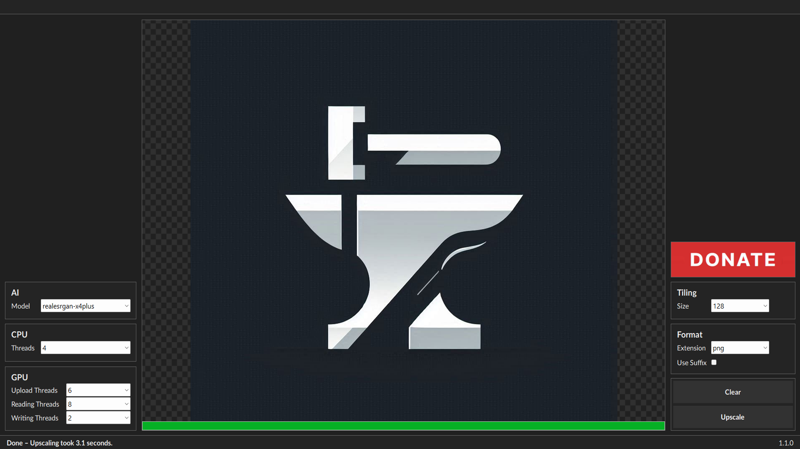

# Sharp Forge

Sharp Forge is a Windows desktop application for batch image upscaling with bundled Real-ESRGAN NCNN Vulkan support and an optional PyTorch CUDA backend. It provides a focused queue-based workflow, live progress, safe cancellation, model discovery, and configurable GPU processing settings.



## Features

- Add multiple images through a file picker or drag and drop.
- Add all supported images located directly inside a dropped folder.
- Preview queued images without locking the source files.
- Discover only complete, validated model installations; unavailable models never appear as placeholders.
- Import standard 4x RGB ESRGAN/RRDB `.pth` checkpoints, including OpenModelDB entries explicitly labeled **ESRGAN**.
- Import DAT/DAT2 and other compatible Spandrel `.pth` or `.safetensors` checkpoints for direct CUDA inference.
- Import existing NCNN `.param`/`.bin` model pairs without conversion.
- Compare the source and upscaled result with a draggable before/after divider.
- Control tile size, GPU ID, pipeline thread counts, and concurrent jobs.
- Save results to a model-specific directory or beside each source file with a suffix.
- Skip outputs that already exist.
- Cancel active processes without leaving incomplete output files behind.
- View per-file progress and a final completed, skipped, and failed summary.

Supported input extensions are BMP, GIF, JPEG, PNG, TIFF, and WebP. Sharp Forge writes PNG, JPEG, or high-quality BC7 DDS output. DDS output retains transparency and includes a complete mip chain for texture-replacement workflows while using about one third of the disk space required by the previous uncompressed BGRA layout.

## Requirements

- Windows 10 or later.
- A Vulkan-capable GPU with a current graphics driver.
- An NVIDIA CUDA-capable GPU with a current driver when using the optional PyTorch backend.
- The .NET 8 Desktop Runtime to run a framework-dependent build.
- The .NET 8 SDK or later to build from source.

## Development setup

1. Clone the repository.
2. Run `Build\Setup.bat` once. The script downloads the pinned Real-ESRGAN runtime and PyTorch-to-NCNN model converter into `SharpForge\Runtime\realesrgan`.
3. Build the solution:

   ```powershell
   dotnet build SharpForge.sln --configuration Debug
   ```

4. Run the application:

   ```powershell
   dotnet run --project SharpForge\SharpForge.csproj
   ```

You can also pass image or directory paths directly to the executable. This supports shortcuts and Windows **Open with** workflows.

The project copies the local runtime and model files to the build and publish output directories. Runtime binaries are intentionally excluded from Git.

## Usage

1. Select **Add images**, or drop supported images or a folder onto the preview area.
2. Select a queued image to inspect its preview.
3. Choose an available AI model and output format. Use **Import Model** to add a compatible `.pth`/`.safetensors` checkpoint or NCNN `.param`/`.bin` pair.
4. Keep **Concurrent jobs** at `1` unless the GPU has enough memory for multiple Real-ESRGAN processes.
5. Reduce **Tile size** if Real-ESRGAN reports an out-of-memory error.
6. Select **Start upscaling**. The same button can safely cancel the active batch.

After a result exists for the selected source and settings, the preview displays the source on the left and the upscaled output on the right. Drag the vertical divider to inspect matching areas.

Standard 4x RGB ESRGAN/RRDB checkpoints from OpenModelDB are converted to the bundled NCNN runtime. DAT/DAT2 checkpoints such as PBRify, and other image models recognized by Spandrel, run directly through the optional PyTorch CUDA backend. Sharp Forge asks for confirmation before downloading this isolated, several-gigabyte runtime into the current user's local application data. Declining the download leaves the bundled NCNN workflow unchanged. Imported models only appear in the model list after their files and backend pass validation.

The direct CUDA backend keeps one model loaded while processing a batch, uses overlap-aware tiling, and preserves an existing alpha channel without sending it through an RGB model. Reduce the tile size if CUDA reports insufficient GPU memory.

DDS output uses maximum-quality BC7 block compression through Microsoft DirectXTex, with alpha-aware mip generation. BC7 is visually high quality and substantially smaller than uncompressed DDS, but it is not mathematically lossless; choose PNG when exact pixel preservation is more important than GPU-ready DDS storage.

By default, output files are written to a directory named `_Upscaled (model-name)` beside each source directory. When the suffix option is enabled, each output is stored beside its source as `file-name (model-name).extension`.

## Architecture

The application keeps UI concerns separate from runtime and batch-processing concerns:

```text
SharpForge/
├── Configuration/   Runtime path configuration
├── Models/          Immutable options, progress, and result types
├── Services/        File discovery, model discovery, output paths, and processing
├── Source/          WinForms windows and interaction logic
└── Resources/       Application icons and images
```

`IImageUpscaler` is the process boundary. `ImageUpscalerRouter` selects either the NCNN Vulkan process or the persistent PyTorch CUDA worker from the validated model metadata. `UpscaleBatchProcessor` owns bounded concurrency, output directory creation, skip behavior, and progress aggregation. The main form captures one immutable settings snapshot before starting background work and only updates controls through UI-thread progress callbacks.

## Publishing

Install the local runtime first, then publish normally:

```powershell
dotnet publish SharpForge\SharpForge.csproj --configuration Release --runtime win-x64 --self-contained false
```

Verify that the publish output contains `realesrgan\realesrgan-ncnn-vulkan.exe` and the `realesrgan\models` directory before distributing it.

## Third-party software and assets

Sharp Forge uses [Real-ESRGAN](https://github.com/xinntao/Real-ESRGAN) for AI image upscaling. Real-ESRGAN is distributed under its own license.

The setup script installs the MIT-licensed [Cupscale](https://github.com/n00mkrad/cupscale) PyTorch-to-NCNN converter for compatible ESRGAN model imports. Because PyTorch `.pth` checkpoints use pickle-based serialization, only import checkpoints from sources you trust.

The optional direct-inference backend installs [PyTorch](https://github.com/pytorch/pytorch), [torchvision](https://github.com/pytorch/vision), [Spandrel](https://github.com/chaiNNer-org/spandrel), and their dependencies into isolated per-user application data. [uv](https://github.com/astral-sh/uv) performs the pinned installation after its archive passes SHA-256 verification. Each component remains subject to its own license.

DDS compression and preview conversion use the MIT-licensed [Microsoft DirectXTex](https://github.com/microsoft/DirectXTex) `texconv` utility.

The interface renders embedded [Lucide](https://lucide.dev/) SVG icons through [SVG.NET](https://github.com/svg-net/SVG). Lucide icons are distributed under the ISC License, included beside the SVG assets. SVG.NET is distributed under the Microsoft Public License.

The flag icons are attributed to their respective Flaticon creators:

- Brazil icon by High Quality Icons.
- United States icon by Freepik.
- European Union icon by Marcus Christensen.

Sharp Forge was also inspired by [Cupscale](https://github.com/n00mkrad/cupscale).

## License

Sharp Forge is licensed under the BSD 3-Clause License. See [LICENSE](LICENSE) for the complete terms.

Users are responsible for ensuring they have the legal right to process their source images. Image enhancement does not grant rights to copyrighted material.
